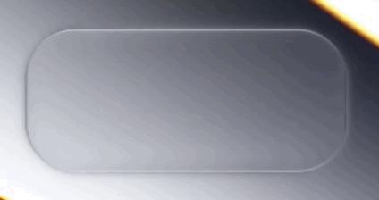
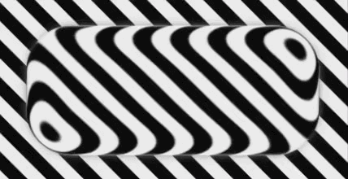
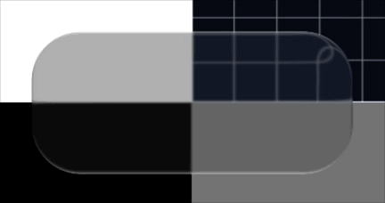
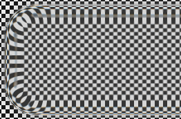
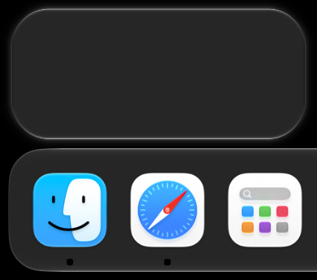
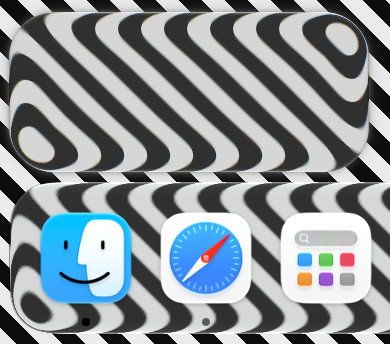
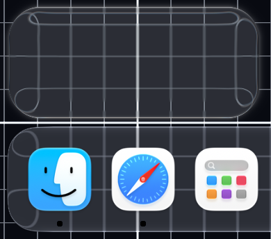

<div align="center">

# liquid-glass-webgl

**液态玻璃 / liquid glass for WebGL2**

physically-based refraction · single-file · zero-dependency

[](LICENSE)




<table>
  <tr>
    <td align="center" width="50%">
      <br>
      <sub><b>磨砂</b> — σ = blur px，全程线性</sub>
    </td>
    <td align="center" width="50%">
      <br>
      <sub><b>玻色</b> — 浅 / 深双模式透过率</sub>
    </td>
  </tr>
</table>

</div>

---

## Features

| | |
|:---|:---|
| **真实折射** — 斯涅尔定律驱动的位移场，不是滤镜近似；玻璃拖过色块时边缘环出现**倒像** | **对折位移场** — 采样映射在环内带极小值（对折点），外侧半环倒序成像，对折线弯出缓 U |
| **Schlick 菲涅尔** — 边缘各边天然比背景略亮，反光颜色取自周边环境而非写死的白 | **玻色**（玻璃自色）— 浅 / 深双模式透过率标定（`tint` = ±1） |
| **Cauchy 色散** — R/G/B 采样距离微差 | **多块堆叠** — `rects` 数组自后向前合成；开 `nested` 则重叠处上层玻璃**折射下层玻璃**（光学嵌套），关则上层遮挡（更快） |
| **单文件零依赖** — 一个 `.js`，无构建要求，支持 WebGL2 即可 | **逐帧可调** — 位置、尺寸与全部光学参数逐帧生效，适配动效与交互动画 |

---

## Gallery

<details>
<summary><b>液态玻璃对比 · 细节</b></summary>
<br>

| macOS Liquid Glass | liquid-glass-webgl |
|:---:|:---:|
|  |  |

<br>

| 纯黑背景下的轮廓 | 对折线 | 边缘倒像环 |
|:---:|:---:|:---:|
|  |  |  |

</details>

---

## Quick Start

ESM 单文件，直接 import 即可——无构建步骤、无依赖；需要 WebGL2（当前所有
主流浏览器均支持）。

```js
import { createLiquidGlass } from './liquid-glass-webgl.js';

// 全屏背景片元着色器（GLSL ES 3.0）——引擎不内置背景，渲进纹理后折射采样
const background = `#version 300 es
precision highp float;
uniform vec2 uRes;
out vec4 outColor;
void main() { outColor = vec4(gl_FragCoord.xy / uRes, 0.5, 1.0); }`;

const glass = createLiquidGlass(canvas, { background });
glass.start();
```

玻璃的位置、尺寸与光学参数逐帧生效：

```js
glass.rect.x = 480;            // 中心坐标（设备像素，y 向上）；rect 即 rects[0]
glass.params.radius = 55;      // 圆角
glass.params.dist = 50;        // 采样距离

glass.start(); glass.stop(); glass.dispose();
```

多块玻璃：数组顺序 = 堆叠顺序（自后向前）。每项可单独覆盖任意光学字段，
未给出的回落到全局 `params`：

```js
glass.rects.push({ x: 900, y: 400, w: 220, h: 220, radius: 110 });
glass.rects.push({ x: 500, y: 300, w: 360, h: 160, dist: 70 });  // 这块采样距离不同
```

重叠时两种合成：`nested: false`（默认）上层遮挡下层，成本与分散面板相同；
`nested: true`（或运行时 `glass.nested = true`）逐层合成，重叠处上层的倒像里
能看到下层玻璃被弯折——玻璃压玻璃的光学嵌套，多一层合成税。

---

---

## API

### createLiquidGlass(canvas, opts?)

| 选项 | 默认 | 说明 |
|:---|:---|:---|
| `background` | — | 全屏背景片元着色器（GLSL ES 3.0）；声明 `uniform float uTime`（秒）即逐帧动画 |
| `transparent` | `false` | 透明三明治模式：画布不铺底，只画玻璃本体，页面真实背景从画布透出（DOM 混合不受影响） |
| `nested` | `false` | 重叠玻璃的光学嵌套（上层折射下层）；仅包围盒相交时启用逐层合成，不相交自动走单目标叠画 |

### 实例

| 成员 | 说明 |
|:---|:---|
| `params` | 全局光学参数（见 Parameters 表），逐帧可写 |
| `rects` | 玻璃面板数组；顺序 = 堆叠顺序（自后向前）；每项可覆盖任意光学字段 |
| `rect` | `rects[0]` 的别名（单面板用法） |
| `nested` | 运行时切换嵌套折射 |
| `render(now?, width?, height?)` | 外部驱动渲一帧（挂进自有帧循环，与 `stop()` 配套）；内部 rAF 运行期间调用会被忽略；可选 width/height 显式指定绘制缓冲尺寸（局部画布/离屏渲染） |
| `start()` / `stop()` | 内部 rAF 循环开关 |
| `dispose()` | 释放全部 GL 资源 |
| `fps` | 最近半秒的实测帧率 |

### 背景注入

两条路，二选一：

1. **着色器背景** — `opts.background` 传全屏片元着色器（见 Quick Start）。
   声明 `uTime` 则逐帧重画（动画背景）；否则仅在尺寸变化后重画（静态背景，
   mipmap 缓存）。
2. **纹理背景** — `setBackground(src, opts?)` 每帧喂任意 `TexImageSource`（canvas /
   ImageBitmap / video frame…），分辨率可与画布不一致，引擎负责 y 翻转；
   同尺寸源复用 `texSubImage2D`（免纹理重分配）。若调用方已在合成端翻转好 y，
   传 `{ preflipped: true }` 可跳过上传期翻转（建议配 `{ alpha: false }` 画布）。
   动画源逐帧调用；`setBackground(null)` 回退着色器背景。

配合 `transparent: true` 可让玻璃浮在真实页面上：画布透明、只画玻璃本体，
折射采样来自 setBackground 喂入的下方画面。

> **性能** — 默认走单目标叠画快路径；`nested` 仅在包围盒相交时才逐层合成；
> 磨砂预模糊按各玻璃的包围盒局部计算。合成成本与面板数、重叠面积线性相关。

---

## Parameters

| 参数 | 字段 | 默认 | 说明 |
|:---|:---|---:|:---|
| 圆角 | `radius` | 55 | 圆角半径（px） |
| 边缘环宽 | `bevel` | 25 | 折射位移场的作用范围（px） |
| 采样距离 | `dist` | 50 | 边缘最大位移——玻璃拖入色块时「异色被拉进来」的距离 |
| 倒像陡度 | `fold` | 2.6 | 位移衰减幂次；>1 时场内出现对折点（倒像） |
| 软弯倍率 | `bend` | 3 | 折返点曲率半径的放大系数 |
| 玻璃下磨砂 | `blur` | 1 | 磨砂 σ（px，CSS `blur()` 同口径） |
| 玻色 | `tint` | 1 | 玻璃自色：0 纯透明，+1 浅色模式透过率，−1 深色模式透过率 |
| 色散 | `disp` | 0.5 | R/G/B 采样距离微差 |
| 边缘反光 | `rim` | 0 | Schlick 高光强度 |
| 环境投影 | `envProj` | 0 | 边缘反光取周边背景色（0/1） |

---

## Demo

```bash
python3 -m http.server 8000    # 在仓库根目录执行（demo 要引用上级目录的引擎文件）
# 打开 http://localhost:8000/demo/
```

3×3 测试卡（平色 / 网格 / 斑马 / 棋盘 / 光谱条）+ 全参数滑杆 + 拖拽移动玻璃。

---

## How It Works

**核心机制——对折位移场**：边缘环的采样映射是「显示深度 x → 采样深度 s(x)」，
s 从外缘的采样距离单调递减到内缘的原位，画面倒序成像（倒像）。把玻璃拖进
色块时「进去的部分显示色块外的颜色、越往里进异色越向边缘挤压拉伸」即由此
而来：异色带宽度由采样距离决定，收缩方向永远贴边。衰减够陡时 s 在环内出现
极小值（对折点）——外侧半环倒序，对折处条纹折返。折返顶点是二次曲率拱，
条纹在对折线两侧弯出缓 U、一阶连续会师。

- **几何** — 圆角矩形解析 SDF；方向场取加宽圆角的梯度（消角部中轴折痕），
  倒像场深度取真实边缘 SDF（等深轮廓与可见边缘同心）
- **折射** — `s(x) = x + 采样距离×(1−t)^倒像陡度`，外缘采样最远、内缘原位
- **外侧臂** — 四分之一椭圆弧（边界条件定形：v 半轴 = 采样距离−sMin、
  u 半轴 = 折线深度），内侧臂用曲率缩放保持顶点二次曲率
- **对折线光带** — 映射斜率 → 0 处的细线
- **边缘光** — Schlick 近似 + 环境取色 + 常量底光兜底
- **色散** — R/G/B 三通道各算位移（Cauchy 型 η(λ)）
- **磨砂** — 分离高斯预模糊纹（σ=blur px，全程线性），均匀作用于折射后的
  画面；折射几何恒定（对折线不随磨砂移动）；位移重采样锯齿靠 RGSS 足迹
  超采样消除（像素足迹在源侧被 |s′| 拉长，铺 4 点覆盖率采样）
- **玻色** — 双模式透过率标定（`tint` 取正负切换）：浅色 `0.748·c + 38/255`
  （压高提低）+ 彩度不对称扩张（亮 ×1.36、暗 ×2.09）；深色 `0.047 + 0.643·c^0.8`
  + 彩度扩张（亮 ×1.8、暗 ×2.25）

<details>
<summary><b>调参注意 · 会调出异常的点</b></summary>

- **磨砂**宽核必须走预模糊 pass（分离高斯）——玻璃内十余点采样卷 σ≳4px
  的大核等价于错位拷贝叠加（重影），不构成磨砂。卷积抽头自身也须作用于
  **带限**内容：细线（≈2px）比抽头间距窄时会被离散抽头解成等间距亮斑
  （周期=间距），取样前需用 mip 盒滤预滤波至间距尺度。位移重采样锯齿
  以模糊近似抗锯齿无效（宽度受限即暴露），应按像素足迹做覆盖率超采样
- **软弯倍率**只作用于内侧臂，且必须用曲率缩放（g′(0)>0）。磨圆式软化
 （g′(0)=0）会把折返顶点拉成平顶 → 对折线变宽、顶点下图像被拉直
- **圆角**变化时轮廓必须保持同心等深。倒像场深度若误用加宽 SDF，圆角调到
  60-80 段会出现边缘折线、形状冻结
- **倒像陡度** ≤1、或 采样距离×陡度 ≤ 边缘环宽 时对折点消失，退化为纯单调
  映射（没有倒像）
- 一切 `exp(-depth/k)` 型轮廓项必须钳在玻璃内（`max(depth,0)`）。玻璃外
  depth<0 会溢出为 Inf，`Inf×0=NaN` 把大片画面抹黑，黑区边界沿遮罩零线走，
  呈直边状假投影
- 轮廓遮罩的法线必须取真实边缘 SDF。取加宽 SDF 的方向场时弯角区法线偏掉，
  白黑两档互相染边
- 玻色系数是透过率表的响应，改系数即偏离该表

</details>

---

<div align="center">

[MIT](LICENSE) © 2026 HaodongWen

</div>
