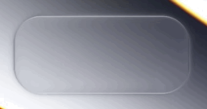
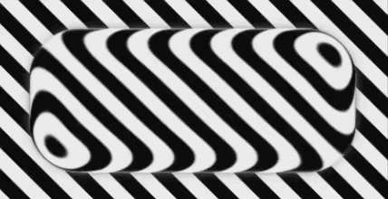
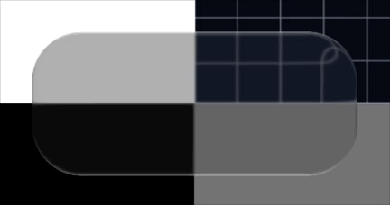
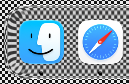
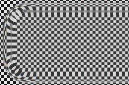
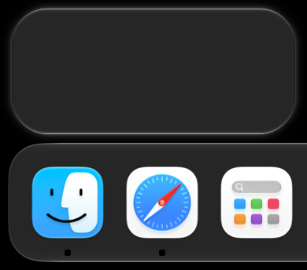
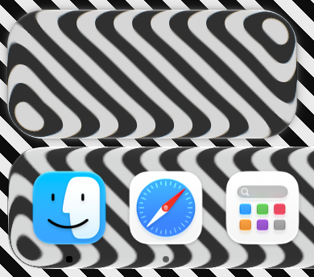
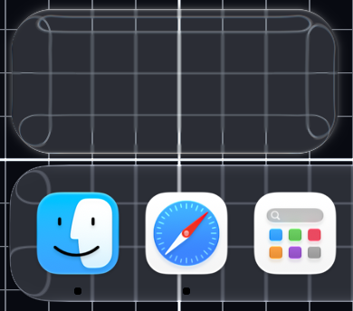

<div align="center">

# liquid-glass-webgl

**液态玻璃 / liquid glass for WebGL2**

screen-space refraction · single-file · zero-dependency

[English guide](README.en.md)

[](LICENSE)




<table>
  <tr>
    <td align="center" width="50%">
      <br>
      <sub><b>磨砂</b> — σ = blur px，全程线性</sub>
    </td>
    <td align="center" width="50%">
      <br>
      <sub><b>玻色</b> — 浅 / 深双模式透过率</sub>
    </td>
  </tr>
</table>

</div>

---

## Features

| | |
|:---|:---|
| **屏幕空间折射** — 圆角矩形的距离场驱动背景重采样，玻璃边缘形成倒像 | **对折位移场** — 外臂采用四分之一椭圆，内臂平滑接回平面，磨砂变化时折线位置固定 |
| **反光** — 可开启 Schlick 边缘光带观察折线位置 | **玻色** — 浅色与深色模式分别按透过率样本标定 |
| **RGB 色散** — 三通道具有独立采样偏移 | **多块堆叠** — 逐面板覆盖参数，重叠时可让上层折射下层 |
| **按需绘制** — 静态画面休眠，着色器动画逐帧更新 | **单文件零依赖** — 直接导入 JS 模块，内含 JSDoc 类型提示 |

---

## Gallery

<details>
<summary><b>液态玻璃对比 · 细节</b></summary>
<br>

| macOS Liquid Glass | liquid-glass-webgl |
|:---:|:---:|
|  |  |

<br>

| 纯黑背景下的轮廓 | 对折线 | 边缘倒像环 |
|:---:|:---:|:---:|
|  |  |  |

</details>

---

## Quick Start

只需复制并导入 `liquid-glass-webgl.js`。编辑器可从文件内的 JSDoc 补全参数，TypeScript 项目开启 `allowJs` 即可读取这些类型。

```js
import { createLiquidGlass } from './liquid-glass-webgl.js';

// 全屏背景片元着色器（GLSL ES 3.0）——引擎不内置背景，渲进纹理后折射采样
const background = `#version 300 es
precision highp float;
uniform vec2 uRes;
out vec4 outColor;
void main() { outColor = vec4(gl_FragCoord.xy / uRes, 0.5, 1.0); }`;

const glass = createLiquidGlass(canvas, { background });
glass.start();
```

玻璃的位置、尺寸与光学参数逐帧生效：

```js
glass.rect.x = 480;            // 中心坐标（设备像素，y 向上）；rect 即 rects[0]
glass.params.radius = 55;      // 圆角
glass.params.dist = 50;        // 采样距离

glass.start(); glass.stop(); glass.dispose();
```

多块玻璃：数组顺序 = 堆叠顺序（自后向前）。每项可单独覆盖任意光学字段，
未给出的回落到全局 `params`：

```js
glass.rects.push({ x: 900, y: 400, w: 220, h: 220, radius: 110 });
glass.rects.push({ x: 500, y: 300, w: 360, h: 160, dist: 70 });  // 这块采样距离不同
```

重叠时两种合成：`nested: false`（默认）上层遮挡下层，成本与分散面板相同；
`nested: true`（或运行时 `glass.nested = true`）逐层合成，重叠处上层的倒像里
能看到下层玻璃被弯折——玻璃压玻璃的光学嵌套，多一层合成税。

---

## API

### createLiquidGlass(canvas, opts?)

| 选项 | 默认 | 说明 |
|:---|:---|:---|
| `background` | — | 全屏背景片元着色器（GLSL ES 3.0）；声明 `uniform float uTime`（秒）即逐帧动画 |
| `transparent` | `false` | 透明三明治模式：画布不铺底，只画玻璃本体，页面真实背景从画布透出（DOM 混合不受影响） |
| `nested` | `false` | 重叠玻璃的光学嵌套（上层折射下层）；仅包围盒相交时启用逐层合成，不相交自动走单目标叠画 |

### 实例

| 成员 | 说明 |
|:---|:---|
| `params` | 全局光学参数（见 Parameters 表），逐帧可写 |
| `rects` | 玻璃面板数组；顺序 = 堆叠顺序（自后向前）；每项可覆盖任意光学字段 |
| `rect` | `rects[0]` 的别名（单面板用法） |
| `nested` | 运行时切换嵌套折射 |
| `render(now?, width?, height?)` | 外部驱动渲一帧（挂进自有帧循环，与 `stop()` 配套）；内部 rAF 运行期间调用会被忽略；可选 width/height 显式指定绘制缓冲尺寸（局部画布/离屏渲染） |
| `start()` / `stop()` | 启停内部调度。默认每帧检查公开参数与面板数值，静止时跳过所有 GL 绘制 |
| `start({ onDemand: true })` | 事件驱动调度。静态画面绘制后暂停 rAF，适合 UI 面板或视频帧回调 |
| `invalidate()` | 通知内部调度器重新绘制；同帧多次调用合并。事件驱动模式下，直接改写 `params` 或 `rects` 后调用 |
| `dispose()` | 释放全部 GL 资源 |
| `fps` | 最近一个采样窗口的实际绘制帧率，空闲后回到 0 |

### 背景注入

着色器背景通过 `opts.background` 注入。使用了 `uniform float uTime` 的着色器随时间重画，静态着色器在尺寸变化或切回时重画。

`setBackground(src, options?)` 接受 canvas、图片、视频、ImageBitmap 等像素源，源分辨率可与显示画布不同。静态图片上传一次即可。可变源每次提交都更新，同尺寸复用纹理存储。传入 `{ version }` 时，相同源、尺寸、翻转方向与版本会复用上次上传。若源已完成 Y 翻转，可传 `{ preflipped: true }`。`setBackground(null)` 切回着色器背景。

```js
glass.start({ onDemand: true });

slider.addEventListener('input', () => {
  glass.params.blur = Number(slider.value);
  glass.invalidate();
});

// video 为已开始播放、支持视频帧回调的 HTMLVideoElement。
function onVideoFrame() {
  glass.setBackground(video);
  video.requestVideoFrameCallback(onVideoFrame);
}
video.requestVideoFrameCallback(onVideoFrame);
```

`setBackground`、`nested`、画布 CSS 尺寸和设备像素比的变化会自动唤醒内部调度。手动调用 `render(now, width, height)` 可直接指定绘制分辨率；省略尺寸时按 CSS 尺寸与设备像素比计算，像素比上限为 2。

**缓存与显存**　磨砂在玻璃覆盖区及采样边界内以设备分辨率计算。只改玻色会复用卷积结果；背景、磨砂半径、采样范围或下层合成变化时，相应缓存失效。多块面板共享横向卷积工作纹理，最终磨砂缓存总面积至多一张画布。需要嵌套折射时才分配层间纹理，两块相交面板仅需一张。

**页面集成**　透明模式只绘制玻璃，实际 DOM 背景由页面显示，折射所需的像素由调用方提供。上下文恢复后引擎会重建 GPU 资源并重绘；使用已关闭的 ImageBitmap 或 VideoFrame 时，接入方需提交新的可读帧。demo 在缺少 WebGL2 时显示 CSS 磨砂预览。[DOM 元素跟踪示例](README.en.md#tracking-a-dom-element)

---

## Parameters

| 参数 | 字段 | 默认 | 说明 |
|:---|:---|---:|:---|
| 圆角 | `radius` | 55 | 圆角半径（px） |
| 边缘环宽 | `bevel` | 25 | 折射位移场的作用范围（px） |
| 采样距离 | `dist` | 50 | 边缘最大位移——玻璃拖入色块时「异色被拉进来」的距离 |
| 倒像陡度 | `fold` | 2.6 | 位移衰减幂次；>1 时场内出现对折点（倒像） |
| 软弯倍率 | `bend` | 3 | 折返点曲率半径的放大系数 |
| 玻璃下磨砂 | `blur` | 1 | 高斯 σ（设备像素），最小 0.5；demo 满档 16 即 σ=16 |
| 玻色 | `tint` | 1 | 玻璃自色：0 纯透明，+1 浅色模式透过率，−1 深色模式透过率 |
| 色散 | `disp` | 0.5 | R/G/B 采样距离微差 |
| 边缘反光 | `rim` | 0 | Schlick 高光强度 |
| 环境投影 | `envProj` | 0 | 边缘反光取周边背景色（0/1） |

---

## Demo

```bash
python3 -m http.server 8000    # 在仓库根目录执行（demo 要引用上级目录的引擎文件）
# 打开 http://localhost:8000/demo/
```

测试卡、纯灰、光斑动画可切换，支持滑杆调参、切换预设和拖动玻璃。通过同一服务打开 `/tests/render.html` 可运行 WebGL 回归用例。

---

## How It Works

**核心机制——对折位移场**：边缘环的采样映射是「显示深度 x → 采样深度 s(x)」，
s 在外缘至折点间递减，局部画面倒序成像。把玻璃拖进
色块时「进去的部分显示色块外的颜色、越往里进异色越向边缘挤压拉伸」即由此
而来：异色带宽度由采样距离决定，收缩方向永远贴边。衰减够陡时 s 在环内出现
极小值（对折点）——外侧半环倒序，对折处条纹折返。折返顶点是二次曲率拱，
条纹在对折线两侧弯出缓 U、一阶连续会师。

- **几何** — 圆角矩形解析 SDF；方向场取加宽圆角的梯度（消角部中轴折痕），
  倒像场深度取真实边缘 SDF（等深轮廓与可见边缘同心）
- **折射** — `s(x) = x + 采样距离×(1−t)^倒像陡度`，外缘采样最远、内缘原位
- **外侧臂** — 四分之一椭圆弧（边界条件定形：v 半轴 = 采样距离−sMin、
  u 半轴 = 折线深度），内侧臂用曲率缩放保持顶点二次曲率
- **对折线光带** — 映射斜率 → 0 处的细线
- **边缘光** — Schlick 近似 + 环境取色 + 常量底光兜底
- **色散** — 沿同一法向为 R/G/B 三通道施加不同的采样位移
- **磨砂** — 分离高斯预模糊纹（σ=blur px，全程线性），均匀作用于折射后的
  画面；折射几何恒定（对折线不随磨砂移动）；位移重采样锯齿靠 RGSS 足迹
  超采样消除（像素足迹在源侧被 |s′| 拉长，铺 4 点覆盖率采样）
- **玻色** — 双模式透过率标定（`tint` 取正负切换）：浅色 `0.748·c + 38/255`
  （压高提低）+ 彩度不对称扩张（亮 ×1.36、暗 ×2.09）；深色 `0.047 + 0.643·c^0.8`
  + 彩度扩张（亮 ×1.8、暗 ×2.25）

<details>
<summary><b>调参注意 · 会调出异常的点</b></summary>

- **磨砂**宽核必须走预模糊 pass（分离高斯）——玻璃内十余点采样卷 σ≳4px
  的大核等价于错位拷贝叠加（重影），不构成磨砂。卷积抽头自身也须作用于
  **带限**内容：细线（≈2px）比抽头间距窄时会被离散抽头解成等间距亮斑
  （周期=间距），取样前需用 mip 盒滤预滤波至间距尺度。位移重采样锯齿
  以模糊近似抗锯齿无效（宽度受限即暴露），应按像素足迹做覆盖率超采样
- **软弯倍率**只作用于内侧臂，且必须用曲率缩放（g′(0)>0）。磨圆式软化
 （g′(0)=0）会把折返顶点拉成平顶 → 对折线变宽、顶点下图像被拉直
- **圆角**变化时轮廓必须保持同心等深。倒像场深度若误用加宽 SDF，圆角调到
  60-80 段会出现边缘折线、形状冻结
- **倒像陡度** ≤1、或 采样距离×陡度 ≤ 边缘环宽 时对折点消失，退化为纯单调
  映射（没有倒像）
- 一切 `exp(-depth/k)` 型轮廓项必须钳在玻璃内（`max(depth,0)`）。玻璃外
  depth<0 会溢出为 Inf，`Inf×0=NaN` 把大片画面抹黑，黑区边界沿遮罩零线走，
  呈直边状假投影
- 轮廓遮罩的法线必须取真实边缘 SDF。取加宽 SDF 的方向场时弯角区法线偏掉，
  白黑两档互相染边
- 玻色系数是透过率表的响应，改系数即偏离该表

</details>

---

<div align="center">

[MIT](LICENSE) © 2026 HaodongWen

</div>
